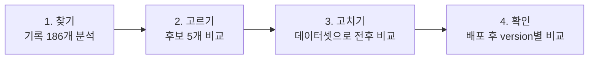
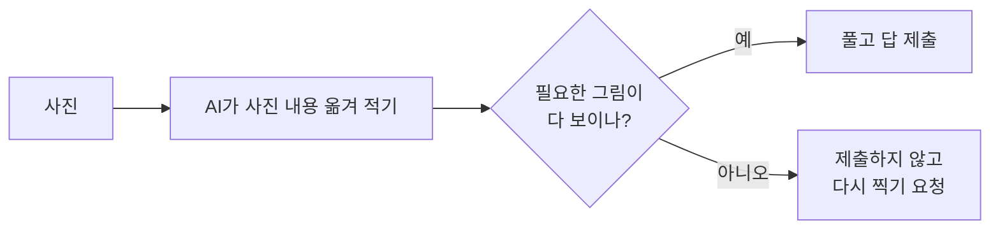

# 퀴즈 에이전트, 기록을 보고 고치기

> **Main Quest 08 · 로그와 피드백으로 에이전트 개선하기**

## 한눈에 보기

| | |
| --- | --- |
| **고친 서비스** | 퀴즈 대결 에이전트: 폰으로 퀴즈 화면을 찍으면 AI가 풀어서 답을 제출 |
| **찾은 문제** | 사진에 그림이 덜 찍히면, AI가 "안 보인다"고 말하면서도 **짐작으로 답을 내서 0점** |
| **고친 방법** | 답하기 전에 **필요한 그림이 다 보이는지 먼저 판단**하고, 안 보이면 다시 찍게 함 |
| **결과** | 데이터셋: 짐작으로 낸 답 **10건 → 0건**, 정상 사진 정답률 **100% 유지** 배포 후 version 비교: 틀린 답 제출 **3건 → 0건** |

---

## 1. 찾기: 기록에서 문제를 찾았다

### 어떤 기록을 봤나

- Langfuse에 남은 퀴즈 풀이 기록 **186개** (11월 6~7일)
- 기록에는 AI가 쓴 풀이 과정이 전부 남아 있었다.
- 하지만 **"맞았는지 틀렸는지"는 남아 있지 않았다.**

### 정답을 어떻게 알아냈나

11월 6일 대회에서 **같은 15문제를 두 번** 풀었다.

- 한 번은 **사진**으로 (하드모드)
- 한 번은 **글**로 (이지모드)

글로 푼 답을 기준으로 사진 답을 하나씩 비교했다. 15문제 중 **12문제는 답이 같았고, 3문제가 달랐다.**

### 달랐던 3문제에서 AI가 남긴 말

근거 기록(Langfuse trace ID)은 아래 후보 표의 A 행에 순서대로 적었다.

| 문제 | AI가 남긴 말 (기록 그대로) | 사진 답 | 글 답 |
| --- | --- | --- | --- |
| 정사각형 세기 | "화면에 그림이 **보이지 않아** … 3×3 격자를 **가정**해" | 14 | — |
| 그래프 최단 거리 | "그래프 그림이 **보이지 않아** … 7은 **추측**한 값입니다" | 7 | — |
| 가격표 합계 | "수량 열은 사진에서 **읽을 수 없어** 각 1개로 **가정**" | 280,000 | **382,000** |

> [!IMPORTANT]
> AI는 그림이 안 보인다는 걸 **알고 있었다.** 그런데도 짐작으로 답을 냈고, 셋 다 틀렸다.

### 찾은 문제 후보 5개

| | 문제 | 몇 번 있었나 | 근거 기록 |
| --- | --- | --- | --- |
| **A** | 사진에 그림이 덜 찍혀 **짐작으로 답함** | 대회 사진 15개 중 3개 (20%) 사진 문제 전체 87개 중 5개 | `3720aae398cacb77c766368803406322` `c20b9efc150727c7d641c3fe274c8bea` `26c592f3909ed1efeec3427e2f8877d7` |
| B | 답 형식을 어김 (JSON 앞에 풀이를 길게 씀) | 137개 중 8개 | `69512806ffec9bd40d07d43910ccb08d` `45f03669ff060311d181eb7cda1299a4` |
| C | 가끔 응답이 매우 느림 (최대 11초) | 사진 문제의 상위 10% | `1d461ed716f3befa871ac6eb4770555f` (11.0초) |
| D | 토큰·비용이 기록되지 않음 | 7개 | `f73510a308c86fb9a03f873a8f0510e9` `e09b1829c972b1e8fe353e2bd6496015` |
| E | 기록에 정답/오답, 사진 원본이 없음 | 전체 | — |

---

## 2. 고르기: A를 먼저 고쳤다

| 후보 | 얼마나 자주 | 얼마나 아픈가 | 고치기 어려운가 | 결정 |
| --- | --- | --- | --- | --- |
| **A. 짐작 답** | 대회 사진의 20% | **큼**: 틀리면 0점 | 보통 | ✅ **먼저 고침** |
| B. 형식 어김 | 형식을 바꾼 뒤 **0/57** | 이미 사라짐 | 쉬움 | 재발 방지 테스트만 |
| C. 느린 응답 | 사진 문제의 10% | 속도 점수 일부 | 쉬움 | 모델을 바꿔 해결 |
| D. 비용 누락 | 7개 | 작음 | 쉬움 | 나중에 |
| E. 기록 빈칸 | 전체 | 개선 확인이 어려움 | 쉬움 | A를 고치며 함께 보완 |

**A를 고른 이유 세 가지**

1. **실제 대회에서 점수를 잃었다.** 맞히면 1,000점이고 속도 보너스는 최대 500점이다. 빠른 것보다 맞히는 게 훨씬 중요하다.
2. **기록만으로 다시 셀 수 있다.** AI가 "보이지 않아", "가정", "추측"이라고 스스로 적어 두기 때문이다.
3. **원인과 해결 방향이 분명하다.** 모델 실력이 아니라 사진이 문제였다. 다시 찍으면 된다.

---

## 3. 고치기: 같은 데이터셋으로 전후를 비교했다

### 데이터셋 만들기

대회 원본 그림은 서버에서 내려가 있어서, **같은 종류의 문제 6개를 직접 만들어** 노트북에 띄우고 폰으로 찍었다.

| 문제 | 무엇을 묻나 | 정답 |
| --- | --- | --- |
| d1 | 빨간 삼각형 개수 | 5 |
| d2 | 정사각형 개수 | 8 |
| d3 | 그래프 최단 거리 | 11 |
| d4 | 뒤집힌 글자 읽기 | QUIZ 1109 |
| d5 | 가격표 합계 | 79,000 |
| d6 | 막대그래프 최대 달 | 9월 |

- **정상 사진 6장:** 화면 전체가 반듯하게 찍힌 사진
- **문제 사진 9장:** 정상 사진을 일부러 망가뜨림
  - 아래 잘림 3장
  - 작게 줄임 2장
  - 흐리게 2장
  - 기울임 2장

사진마다 **3번씩** 풀게 했다. 퀴즈 서버에는 제출하지 않았다.

> [!NOTE]
> **짐작 답을 세는 기준:** AI의 풀이에 "보이지 않 / 읽을 수 없 / 가정 / 추측 / 잘려 / 흐릿" 중 하나가 있으면 짐작으로 셌다. 고치기 전과 후에 똑같은 기준을 썼다.

### 무엇을 바꿨나

- AI가 답하기 전에 **"VISIBLE: yes / no"**를 먼저 쓰게 했다.
- **no**면 짐작하지 않고 **"다시 찍어 주세요"**를 돌려준다. 무엇이 안 보이는지도 알려준다.
- 이미 설치된 옛 앱은 다시 찍기를 모르기 때문에, **새 앱이 요청할 때만** 다시 찍기를 쓰게 했다.
- 두 번째 사진도 안 보이면 그때는 **가장 그럴듯한 답을 반드시 낸다.** 답을 안 내면 무조건 0점이기 때문이다.

### 결과

| | 정상 사진 고치기 전 | 정상 사진 고친 후 | 문제 사진 고치기 전 | 문제 사진 고친 후 |
| --- | :---: | :---: | :---: | :---: |
| 정답률 | 100% | **100%** | 48% | 44% |
| **짐작으로 낸 답** | 0 | 0 | **10** | **0** ✅ |
| 다시 찍기 | — | **0** | — | 12 |

**한 줄로:** 짐작 답은 사라졌고, 멀쩡한 사진은 그대로 잘 풀었다.

- 문제 사진 정답률이 조금 내려간 건, 다시 찍기로 넘긴 문제를 "답 없음"으로 셌기 때문이다. 앱이 다시 찍어 보내면 회복될 부분이다.
- 응답 시간은 같은 시간대에 번갈아 재 보니 **+0.2초** 정도로 거의 차이가 없었다.

> [!WARNING]
> **못 잡은 것:** 기울어진 막대그래프(d6)는 AI가 망설임 없이 "7월"이라고 틀렸다. AI가 "안 보인다"고 말하지 않는 오답은 이 방법으로 잡을 수 없다.

---

## 4. 확인: 배포한 뒤 새 기록을 version별로 봤다

배포한 서버: `friend-agent-staging-00095-til`

### 처음 보는 사진으로 확인

데이터셋에 없던 **새 변형 사진 5장**을 보냈다.

| 사진 | 어떻게 망가졌나 | AI 판단 | 결과 |
| --- | --- | --- | --- |
| 그래프 | 오른쪽 끝(E)이 잘림 | 안 보임 | 다시 찍기 ✅ |
| 가격표 | 수량 열이 잘림 | 안 보임 | 다시 찍기 ✅ |
| 정사각형 | 아래 절반이 잘림 | 안 보임 | 다시 찍기 ✅ |
| 빨간 삼각형 | 어둡게 | 보임 | 정답 5 ✅ |
| 뒤집힌 글자 | 3도 기울임 | 보임 | 정답 ✅ |

### version별 비교

고치기 전 동작(`quiz-v1`)과 고친 동작(`quiz-v2-visible`)을 Langfuse `version`으로 기록하게 하고(friend_test PR #44), 두 version을 각각 띄운 리비전에 **같은 새 사진 11장**(새 변형 5장 + 정상 6장)을 보냈다. 제출은 하지 않았다.

| version | 리비전 | 정답 | **틀린 답 제출** | 짐작으로 낸 답 | 다시 찍기 | 평균 응답 시간 |
| --- | --- | :---: | :---: | :---: | :---: | :---: |
| quiz-v1 (고치기 전) | `00099-pog` (0%) | 8/11 | **3** | 2 | 0 | 3.57초 |
| quiz-v2-visible (고친 후) | `00097-dox` (서비스 중) | 8/11 | **0** ✅ | 0 | 3 | 3.86초 (다시 찍기 응답 2.36초) |

**사진별로 보면**

| 사진 | quiz-v1 | quiz-v2-visible |
| --- | --- | --- |
| 그래프, 오른쪽 잘림 (정답 11) | 11, 하지만 "보이지 않·가정·잘려" — **운 좋게 맞힌 짐작** | 다시 찍기: "노드 E와 D·F→E 간선 가중치가 잘림" |
| 가격표, 수량 열 잘림 (정답 79000) | 47300 ❌ — 보이는 가격만 더함 (짐작 표현도 없음) | 다시 찍기: "표 오른쪽 열 잘림" |
| 정사각형, 위쪽만 (정답 8) | 3 ❌ — "가정·잘려" | 다시 찍기: "아래쪽이 잘려 행 수와 모양이 안 보임" |
| 빨간 삼각형, 어둡게 (정답 5) | 5 ✅ | 5 ✅ |
| 뒤집힌 글자, 3도 회전 (정답 QUIZ 1109) | QUIZ 9011 ❌ | QUIZ 1109 ✅ |
| 정상 사진 6장 | 6/6 ✅ | 6/6 ✅ |

**읽는 법**

- 정답 수는 8/11로 같지만 내용이 다르다. v1은 **틀린 답 3개를 그대로 제출**했고, v2는 틀릴 문제를 **제출하지 않고 다시 찍기로 돌렸다.** 다시 찍어 잘 나온 사진을 보내면 이 3개는 맞힐 기회가 생긴다.
- v1이 그래프 문제를 맞힌 건 짐작이 우연히 맞은 것이다. 이런 답은 다음엔 틀릴 수 있다.
- 가격표 문제처럼 **짐작 표현 없이 틀린 답**도 있었다. 짐작 표현만 세면 놓치는 오답을, v2는 "필요한 부분이 다 보이나"를 먼저 따져서 잡아냈다.
- 응답 시간은 v2가 0.29초 길었지만, 다시 찍기로 돌린 응답은 2.36초로 오히려 빨랐다.

> [!NOTE]
> 측정 기록은 Langfuse에서 `eval=version-compare`로 찾을 수 있고, `version` 값으로 `quiz-v1`과 `quiz-v2-visible`이 나뉜다. 원자료: `results/version_compare.json`

---

## 5. 배운 것

1. **기록에 정답이 없으면 무엇이 틀렸는지부터 알 수 없다.** 같은 문제를 글로 푼 기록을 기준 답으로 삼아 겨우 찾았다. 다음부터는 맞았는지 틀렸는지도 기록에 남긴다.
2. **시간은 같은 시간대에 번갈아 재야 한다.** 처음엔 1.1초 느려진 것처럼 보였지만, 실제 차이는 0.2초였다.
3. **기준은 전후에 똑같이 써야 한다.** 짐작을 세는 단어를 늘렸더니 신중하게 맞힌 답까지 짐작으로 잡혔다.
4. **서버를 바꿀 때 이미 설치된 앱을 생각해야 한다.** 다시 찍기를 그냥 넣었으면 옛 앱이 문제를 아예 못 냈을 것이다.

## 6. 다음에 할 일

- [ ] 앱: 다시 찍기 요청을 받으면 바로 다시 찍어서 보내기
- [ ] 망설임 없이 틀리는 사진(기울어짐 등)을 잡는 방법 찾기
- [ ] 퀴즈 서버의 정답/오답을 Langfuse 점수로 남기기

---

파일 안내

| 파일 | 내용 |
| --- | --- |
| `data/questions.json` | 데이터셋 정답과 사진 설명 |
| `data/photos/` | 데이터셋 사진 15장 |
| `data/photos_new/` | 배포 후 확인용 새 사진 5장 |
| `results/before.json`, `results/after.json` | 고치기 전후 측정 원자료 |
| `results/version_compare.json` | version별 배포 후 결과 |
| `analysis/candidates.md` | 문제 후보별 근거 기록 ID |

**관련 코드 변경 (friend_test)**

- PR #42: 보이는지 판단하고 다시 찍기
- PR #43: 두 번째 사진은 반드시 답 내기
- PR #44: 기록에 version 남기기 (`QUIZ_VISIBLE_CHECK`)

